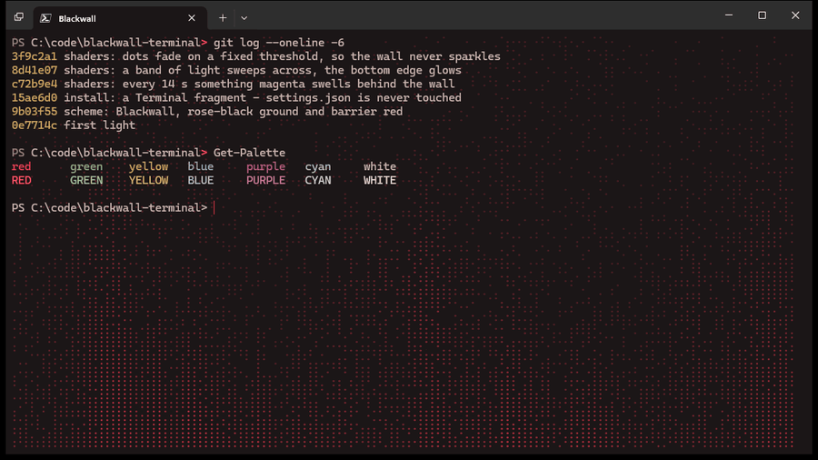

# Blackwall for Windows Terminal



A colour scheme and a GPU pixel shader for Windows Terminal. Behind your text hangs a faint curtain of red LED
dots: strands of light, a band of brightness sweeping across, a glow rising from the bottom edge, and every so
often something magenta swelling behind the wall. Text stays exactly as your shell draws it.

The recording above is a real Terminal tab (captured frame by frame), not a mock-up.

## Install

```powershell
git clone https://github.com/PavolKum/blackwall-terminal
cd blackwall-terminal
pwsh -File install.ps1          # or: powershell -File install.ps1
```

Then close **every** Windows Terminal window, open Terminal again, and pick **Blackwall** from the new-tab menu.
Terminal reads new profiles only when it starts.

The installer writes one folder, `%LOCALAPPDATA%\Microsoft\Windows Terminal\Fragments\BlackwallTerminal`, holding
the scheme, a profile, and a copy of the shader. It never edits your `settings.json`.
- Use a different shell: `pwsh -File install.ps1 -Shell 'C:\Windows\System32\cmd.exe'`
- Remove it: `pwsh -File install.ps1 -Uninstall`

### By hand

Paste `scheme/blackwall.json` into the `schemes` list of your `settings.json`. Then add two lines to any profile:

```json
"colorScheme": "Blackwall",
"experimental.pixelShaderPath": "C:\\path\\to\\blackwall-terminal\\shaders\\blackwall.hlsl"
```

## How it works

Windows Terminal can run a pixel shader over each frame it renders (`experimental.pixelShaderPath`). The shader
receives the frame as a texture, plus the time, the DPI scale, the resolution and the profile's background colour.

- **Background only.** A pixel is touched only if it is within 2% of the profile's background colour on every
  channel. Text, the cursor, selections, and anything an app paints in its own colours pass through unchanged. An
  app that paints its own background, such as vim with a colour scheme, covers the wall. That is by design.
- **Dots, not noise.** The dots sit on an 8 x 6 px lattice, scaled with DPI. Each has a fixed random threshold and
  lights when the local brightness beats it. Brightness is smooth: value noise per strand, times a sine band
  sweeping across, plus an exponential glow rising from the bottom. Because the thresholds never change, dots fade
  in and out as the light passes instead of sparkling frame to frame.
- **The rogue shape.** Every 14 s, a soft magenta shape swells behind the wall for 5 s. Its edge wobbles with
  angular noise.
- **Cheap.** Shader model `ps_4_0`, no textures beyond the frame, a handful of `sin`/`frac` hashes per pixel. It
  runs on the GPU, so the CPU does nothing.

## Tune it

The knobs sit at the top of `shaders/blackwall.hlsl`: `DOT_STRENGTH`, `GHOST_STRENGTH`, `GHOST_EVERY`,
`GHOST_LASTS` and `DOT_PITCH`. If you installed with `install.ps1`, edit the copy in the fragment folder, or edit
the repo copy and run the installer again. Open a new tab to see the change.

Check that it compiles before Terminal sees it: `python tools/check_shader.py shaders/blackwall.hlsl`. It uses
Windows' own `d3dcompiler_47.dll`, the compiler Terminal uses, so no SDK is needed.
`tools/demo.ps1` prints the sample session from the recording.

## Notes

- **GPU:** any Direct3D 11 GPU (NVIDIA, AMD or Intel). Over Remote Desktop or in a VM, Terminal may render in
  software, where the shader is slow or skipped.
- **HDR:** Windows HDR can crush near-black detail. If the dots are invisible on screen but show in a screenshot,
  try with HDR off.
- **Experimental:** pixel shaders are an experimental Terminal feature, as the setting's name says.
- **Not affiliated:** the Blackwall is the barrier from *Cyberpunk 2077* by CD PROJEKT RED. This is an
  independent fan-made theme, not affiliated with or endorsed by CD PROJEKT RED. The shader and the colours are
  original work.

Built with [Claude Code](https://claude.com/claude-code). MIT licence.
